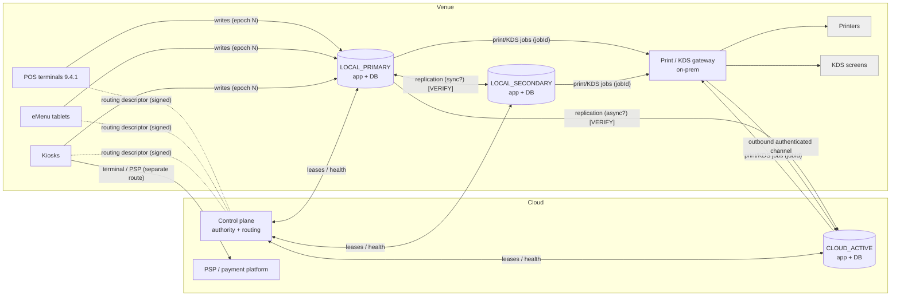
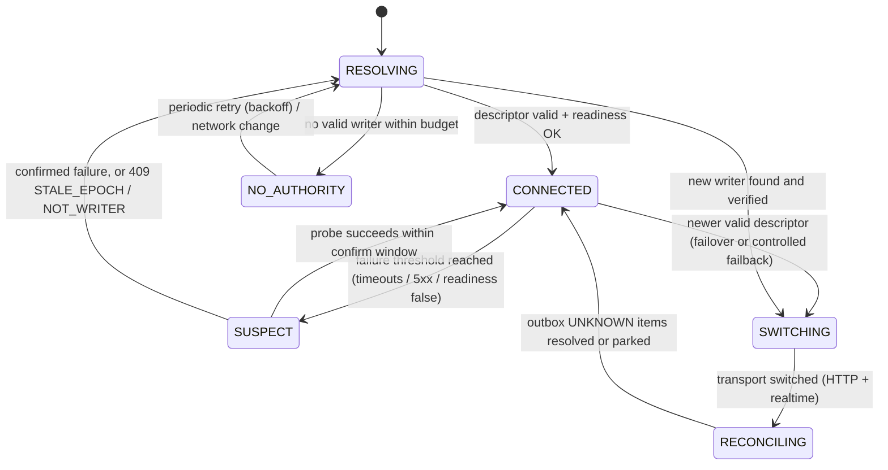
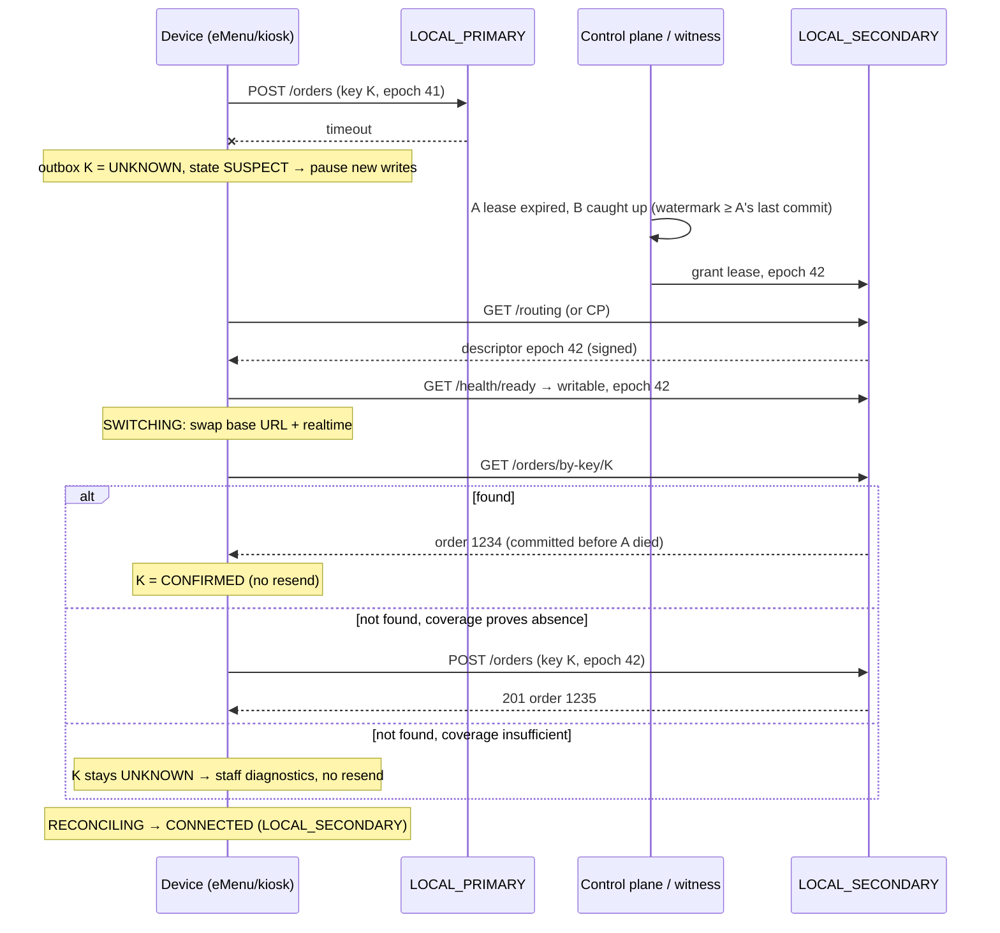

# 01 — Target architecture: endpoint authority, durability, failover and failback

Status markers used in this document: **[REQ]** requirement from the brief · **[DESIGN]** proposed design (adapt to the real code) · **[VERIFY]** must be checked in the Phase 0 audit.

## 1. Server roles

| Role | What it is | Writes allowed when |
|---|---|---|
| `LOCAL_PRIMARY` | On-premises main server (preferred for orders, menus, devices, sessions, kitchen, local workflows) | It holds the current authority lease |
| `LOCAL_SECONDARY` | Optional synchronised on-premises standby | The control plane promoted it (new epoch) after verifying it is synchronised |
| `CLOUD_ACTIVE` | Hosted Guestit cloud fallback | The control plane authorised the cloud for production writes for this venue (new epoch) |
| `DEGRADED / NO_AUTHORITY` | No node is verifiably authorised | Never — devices keep state, take no new authoritative writes |
| *Independent standby* (legacy) | Standby with its own, unsynchronised data | **Never automatically.** Manual recovery configuration only [REQ §2] |

Preference order: LOCAL_PRIMARY → LOCAL_SECONDARY → CLOUD_ACTIVE. The **backend** decides the actual writer [REQ §2, §5].

## 2. Components



- **Control plane [DESIGN]:** decides the writer per venue/domain, issues leases and signed routing descriptors, keeps the replication watermark per node. It must be reachable without the primary, so it runs in the cloud **plus** an on-prem arbiter/witness so LOCAL_SECONDARY can be promoted during a WAN outage. Exact form is a backend decision. If it does not exist → BLOCKED (`09-backend-dependencies.md` D1).
- **Print/KDS gateway [DESIGN]:** an on-prem service that receives jobs from whichever node is writer and keeps routing rules per venue. It holds an *outbound*, authenticated connection to the cloud so cloud-originated orders reach the kitchen even when the POS application service is down [REQ §9]. **[VERIFY]** whether this exists, or whether the POS service itself drives the printers.
- **Payments** go via the terminal/PSP, separate from ordering routing [REQ §8].

## 3. Authority model (epochs, leases, fencing)

**Routing descriptor [DESIGN — see `02-contracts.md` C1]:**
```
{ venueId, tenantId, domain: "ordering",
  epoch: 4711,                                  // monotonic, never reused
  writer: { nodeId: "venue12-B", role: "LOCAL_SECONDARY",
            baseUrls: ["https://10.0.0.12:8443"], wsUrl: "wss://10.0.0.12:8443/rt" },
  leaseUntil: "2026-10-13T12:40:05Z",
  standby: [ { nodeId, role, baseUrls } ],      // read-only candidates, informational
  issuedAt, signature (Ed25519 over canonical JSON, control-plane key) }
```
Rules:
1. Device accepts a descriptor only if: signature valid against the provisioned public key(s), `tenantId`/`venueId` match the device binding, and `epoch > current` (or `==` with the same writer as a refresh).
2. Every write carries `X-Guestit-Epoch: <epoch>` and `X-Guestit-Device: <deviceId>`.
3. A node accepts writes only if it **is** the writer for that epoch **and** its lease is valid (fencing). Otherwise: `409 STALE_EPOCH` (with the current epoch if known) or `503 NOT_WRITER`.
4. A node whose lease expired stops accepting writes **before** the control plane may grant a new lease elsewhere (lease safety margin > clock skew). This is the core split-brain protection [REQ §5].
5. A returning old primary starts **fenced** (read-only, `writable=false`) until the control plane grants it a new epoch [REQ §12].

## 4. Device connection state machine [DESIGN]


- `CONNECTED` carries the role (`LOCAL_PRIMARY | LOCAL_SECONDARY | CLOUD_ACTIVE`) for the status UI.
- In `SUSPECT`, `RESOLVING`, `SWITCHING`, `NO_AUTHORITY`: **new transactional submissions are paused** (queued in the outbox, not sent), browsing continues on cached data, cart and session stay untouched [REQ §4].
- **WAN state** is tracked separately (cloud reachable yes/no). A WAN outage while LOCAL_PRIMARY is healthy changes nothing for ordering [REQ test 4].

**Detection and hysteresis (starting values, tune with tests):**

| Parameter | Start value | Note |
|---|---|---|
| Request timeout (writes) | connect 2 s, read 8 s | A read timeout on a write → `UNKNOWN`, not failure |
| Active probe interval | 5 s while idle; 2 s while SUSPECT | Passive detection from real traffic counts too |
| Failure threshold | 2 consecutive failures within 6 s | Leaves CONNECTED → SUSPECT |
| Confirm window | 3 s | SUSPECT → RESOLVING if still failing |
| Minimum dwell after a switch | 30 s | No further switch unless the new node is confirmed dead or a newer epoch arrives |
| Payment guard | while `PAY_ACTIVE` | No voluntary switch; involuntary switch only if the node is dead |
| NO_AUTHORITY retry | 2 s → 4 → 8 → max 30 s (+ jitter) | Reset on network change callback |

Target detection 2–5 s [REQ §4], never at the cost of safety.

## 5. Failover sequence (primary dies, secondary synchronised)



Cloud takeover (both local nodes unavailable) is the same flow with `CLOUD_ACTIVE`, except that the cloud is usually *behind* (async replication) — see §6.

## 6. Recovery-point guarantees (what can and cannot be promised)

| Category | Where it is durable | Guarantee after... |
|---|---|---|
| Device operation in the outbox, not yet acknowledged | Device (Room) | ...any failure: survives, resubmitted with the same key once absence is proven |
| Acknowledged by LOCAL_PRIMARY, sync-replicated to SECONDARY **[VERIFY]** | A + B | ...loss of A: present on B (RPO 0 locally — *only if* replication is synchronous) |
| Acknowledged by LOCAL_PRIMARY, async to cloud | A (+ B) | ...loss of both local nodes: possibly **not** in the cloud yet (RPO = replication lag) |
| Acknowledged by CLOUD_ACTIVE | Cloud | ...durable in the cloud; copied back to local at failback |
| POS-originated operation on a lost node | That node | ...reconciled at failback; never fabricated or overwritten |

Consequences for clients:
- A "not found" lookup on a node that may be behind is **not** proof of absence. The lookup answer must state its coverage (e.g. "covers everything from node A up to 12:31:07.200"); the device resubmits only if `coverage ≥ time of its first attempt`. Otherwise the operation stays `UNKNOWN` (staff diagnostics; kiosk shows *paid – order being confirmed by staff*).
- The cloud may show a table bill as **possibly incomplete** while it is behind. AYCE rounds and bill totals that depend on missing local data are flagged, not silently recalculated [REQ §10, §11].
- The device journal does not replace server replication; together they bound the loss window. State that, with numbers, in the final architecture note.

## 7. Failback (controlled by the backend)

1. Returning node (e.g. A) boots **fenced**: readiness `writable=false`, `role=RECOVERING`.
2. A catches up from the current writer (cloud or B): orders, payments, print/KDS states, sessions, configuration.
3. Control plane verifies: identity, software compatibility, replication watermark = writer's head, no outstanding print jobs in an uncertain state (or they are reconciled).
4. **Drain:** the control plane announces `handoverAt` in the descriptor; devices finish in-flight writes; new payment starts are briefly held (seconds); open payments continue on the old writer until done.
5. New epoch with A as writer; old writer is fenced immediately (`409 STALE_EPOCH`).
6. Devices switch when idle or between steps — never in the middle of a payment — without losing session or cart.

## 8. Data versions and caches [REQ §10]
- Every read model carries a version: `menuVersion`, `priceListVersion`, `configVersion`, `arrangementVersion`, plus the `epoch`.
- On switching epoch, caches are **revalidated**, not wiped: keep showing the cached menu, compare versions with the new writer, refresh what differs.
- Every order carries the versions it was priced with. The server rejects with `409 PRICE_STALE` / `ARRANGEMENT_EXPIRED` if they are no longer valid; the device re-prices, shows the difference and asks the guest to confirm (kiosk: existing price-change confirmation).

## 9. Security [REQ §13]
- Endpoint provisioning via authenticated device enrollment (existing Guestit device registration **[VERIFY]**); the APK contains no secrets, only the control-plane public key(s) for descriptor signatures (with rotation support: key ID in the descriptor).
- Device identity: per-device credential (token or mTLS client certificate) bound to tenant + venue; rotation supported.
- Cloud: TLS with certificate pinning (primary + backup pin). Local: TLS with a venue CA or mTLS per deployment policy **[VERIFY]**; never plain HTTP for writes.
- A descriptor from an unauthenticated source, with a bad signature, another venue or a lower epoch is rejected and logged.
- Staff overrides (forced endpoint, manual recovery) require staff authentication, are logged with user, time and reason, and never bypass fencing.

## 10. Performance [REQ §14]
- One monitor coroutine per process; probe payload < 1 KB; shared OkHttp/Ktor client and connection pool; at most one realtime socket.
- Outbox bounded (default 500 operations / 5 MB); when 80 % full, a staff warning; never drop operations silently.
- Measure on the reference 2 GB device: memory overhead of the core (< 8 MB target), probe CPU, time to detect, time to switch, UI jank during a switch. If not measured: report "unverified".
